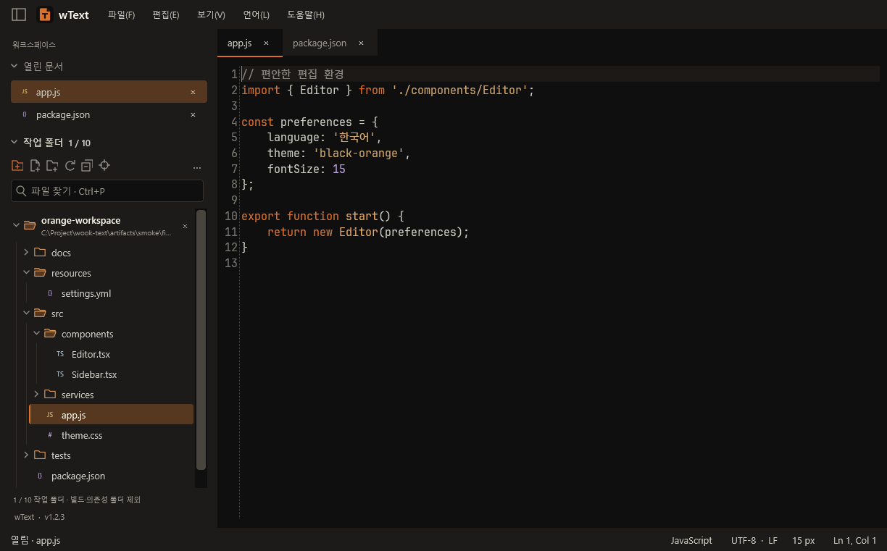

<p align="center">
  
</p>

# wText

Windows x64용 무료 텍스트·PDF 편집기입니다. 여러 문서를 탭으로 편집하고 작업 폴더를 탐색하며, 두 파일이나 붙여넣은 텍스트의 차이를 나란히 확인할 수 있습니다.

구문 강조, 문서 자동 정렬, 찾기·바꾸기, 미니맵, 직사각형 블록 편집과 미저장 작업 복원을 지원합니다. 자세한 조작은 앱의 F1 [설명서](docs/USER-GUIDE.md)와 [기능 안내](docs/FEATURES.md)에서 확인하세요.

**공개 1.8.2:** Ctrl+G의 [줄·열 이동](docs/FEATURES.md#줄로-이동-182)과 100MB 안팎 로그의 청크 로딩·저장, 대용량 모드·스크롤 보정을 함께 제공합니다. 큰 문서는 일부 표시 기능과 본문 자동 복구를 제한하므로 [대용량 사용법](docs/FEATURES.md#대용량-텍스트와-로그-182)을 확인하세요. 사용자가 스크롤 개선을 확인하고 공개를 요청했으며, 새 기능의 자동 Windows WPF·화면·설치 검증은 미실행입니다. [검증·배포 기록](docs/RELEASING.md)에 범위를 구분했습니다.

PDF 읽기·검색·주석·페이지 조작·최상위 글자/이미지 개체 편집과 Markdown/HTML/SVG/CSV·TSV/JSON/XML 미리보기도 제공합니다. [PDF·미리보기 지원 범위](docs/FEATURES.md#pdf와-문서-미리보기-172)를 참고하세요.



위 이미지는 이전 버전의 실제 Windows 검증 화면입니다. C#과 WPF로 개발하며 프로젝트 코드는 MIT 라이선스로 공개합니다.

## 다운로드

**wText 1.8.2 · Windows x64**

- [설치 파일 (.exe)](https://github.com/parkhw328/wook-text/releases/download/v1.8.2/wText-1.8.2-win-x64-setup.exe)
- [무설치 ZIP](https://github.com/parkhw328/wook-text/releases/download/v1.8.2/wText-1.8.2-win-x64-portable.zip) — 전체 압축을 해제한 뒤 `wText.exe` 실행

.NET·PDFium·WebView2 런타임이 포함되어 별도 런타임 설치 없이 실행할 수 있습니다. 설치 EXE와 ZIP은 각각 약 417~419 MiB이며, 최초 미리보기에서 WebView2 사용 조건을 확인합니다.

[릴리스 목록](https://github.com/parkhw328/wook-text/releases) · [SHA-256 체크섬](https://github.com/parkhw328/wook-text/releases/download/v1.8.2/SHA256SUMS.txt)

## 문서

- [앱 내장 기능 설명서 (F1)](docs/USER-GUIDE.md) — 전체 기능·단축키·한도·오류 대응
- [기능 및 사용법](docs/FEATURES.md) — 설치, 기능별 화면, 설정, 단축키
- [개발 안내](docs/DEVELOPMENT.md) — 개발 환경, 빌드·검증·배포, 프로젝트 구조
- [배포 안내](docs/RELEASING.md) — 현재 배포 상태와 검증 결과
- [변경 이력](CHANGELOG.md)
- [요구사항](rules/requirements.md) · [프로젝트 규칙](rules/rules.md)

## 개발

Windows x64의 PowerShell에서 저장소 루트를 기준으로 실행합니다.

```powershell
.\scripts\bootstrap.ps1       # 개발 도구 준비
.\scripts\build.ps1           # 빌드 및 테스트
.\scripts\run.ps1             # 실행
.\scripts\package.ps1         # 설치 파일 및 무설치 ZIP 생성
```

`src/`는 앱과 핵심 로직, `tests/`는 Core·PDF 작업 프로세스·설치 목록·WPF 자동 테스트, `scripts/`와 `installer/`는 개발·배포 도구, `docs/`는 상세 문서입니다.

## 라이선스

[MIT](LICENSE) · [외부 구성요소 고지](THIRD-PARTY-NOTICES.md)

제작: **Hyunwook Park**
