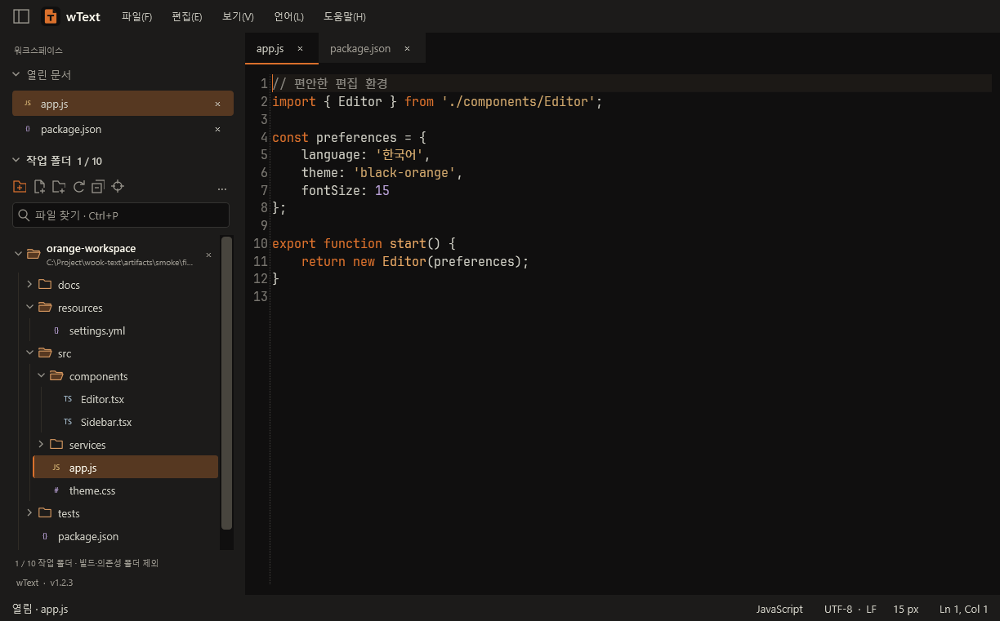

<p align="center">
  
</p>

# wText

Windows x64용 무료 텍스트 편집기입니다. 여러 문서를 탭으로 편집하고, 작업 폴더를 탐색하며, 두 파일이나 붙여넣은 텍스트의 차이를 나란히 확인할 수 있습니다.

구문 강조, 문서 자동 정렬, 찾기·바꾸기와 미저장 작업 복원을 지원합니다.

**1.6.0:** F1 내장 기능 설명서, 우측 미니맵과 표시 설정, 직사각형 블록 복사·붙여넣기, 줄/선택 복제·줄 이동·삭제를 제공합니다. [설명서](docs/USER-GUIDE.md)와 [사용법·단축키](docs/FEATURES.md)를 참고하세요. Linux 교차 빌드로 배포했으며 새 Windows 화면·설치 실행은 아직 검증하지 않았습니다.

열린 파일의 외부 변경을 감지해 알림과 함께 다시 불러오며, 미저장 수정이 있으면 선택을 확인해 작업을 보호합니다. C#과 WPF로 개발하며 MIT 라이선스로 공개합니다.



**1.6.1:** `Shift+방향키 → Ctrl+Alt+B → Ctrl+C`로 마우스 없이 블록을 선택·복사할 수 있습니다. 기존 Alt+드래그도 유지합니다.

**1.6.2:** 짧은 문서의 미니맵을 위쪽에 자연스러운 간격으로 표시하며, 현재 화면·커서 표시와 클릭 이동 좌표도 함께 보정했습니다.

## 다운로드

**wText 1.6.2 · Windows x64**

- [설치 파일 (.exe)](https://github.com/parkhw328/wook-text/releases/download/v1.6.2/wText-1.6.2-win-x64-setup.exe)
- [무설치 ZIP](https://github.com/parkhw328/wook-text/releases/download/v1.6.2/wText-1.6.2-win-x64-portable.zip) — 전체 압축을 해제한 뒤 `wText.exe` 실행

.NET 런타임이 포함되어 있어 별도 설치 없이 실행할 수 있습니다.

[릴리스 목록](https://github.com/parkhw328/wook-text/releases) · [SHA-256 체크섬](https://github.com/parkhw328/wook-text/releases/download/v1.6.2/SHA256SUMS.txt)

## 문서

- [앱 내장 기능 설명서 (F1)](docs/USER-GUIDE.md) — 전체 기능·단축키·한도·오류 대응
- [기능 및 사용법](docs/FEATURES.md) — 설치, 기능별 화면, 설정, 단축키
- [개발 안내](docs/DEVELOPMENT.md) — 개발 환경, 빌드·검증·배포, 프로젝트 구조
- [배포 안내](docs/RELEASING.md) — 현재 배포 상태와 검증 결과
- [변경 이력](CHANGELOG.md)
- [요구사항](docs/REQUIREMENTS.md) · [프로젝트 규칙](rules/rules.md)

## 개발

Windows x64의 PowerShell에서 저장소 루트를 기준으로 실행합니다.

```powershell
.\scripts\bootstrap.ps1       # 개발 도구 준비
.\scripts\build.ps1           # 빌드 및 테스트
.\scripts\run.ps1             # 실행
.\scripts\package.ps1         # 설치 파일 및 무설치 ZIP 생성
```

`src/`는 앱과 핵심 로직, `tests/`는 자동 테스트, `scripts/`와 `installer/`는 개발·배포 도구, `docs/`는 상세 문서입니다.

## 라이선스

[MIT](LICENSE) · [외부 구성요소 고지](THIRD-PARTY-NOTICES.md)

제작: **Hyunwook Park**
