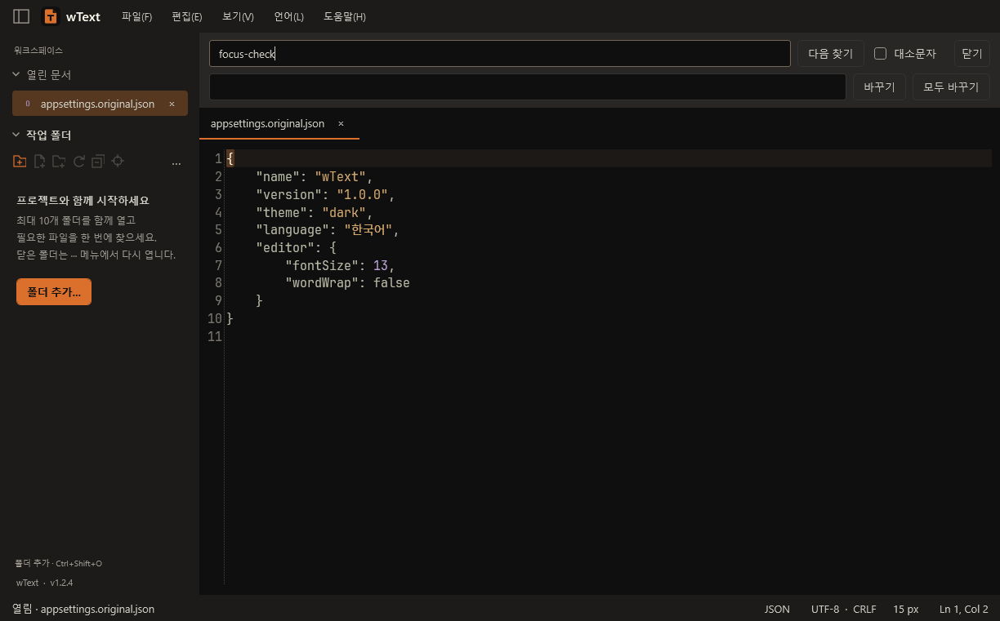
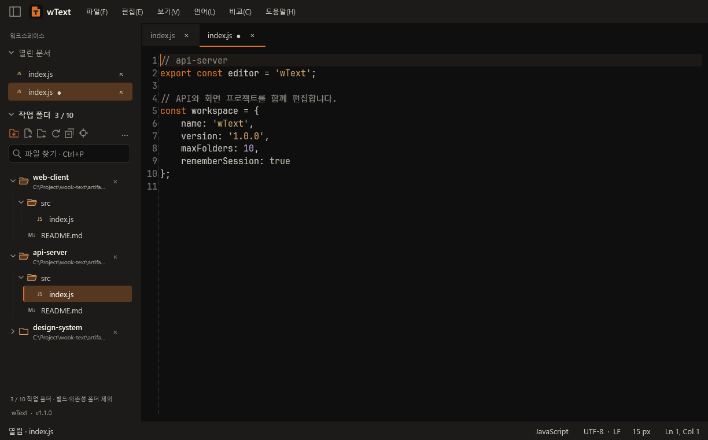
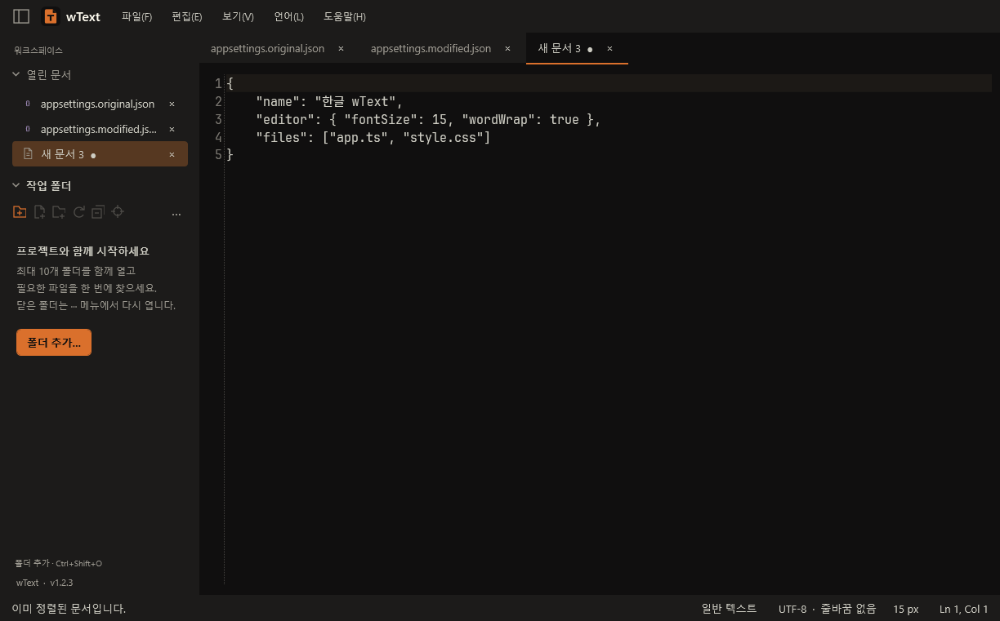
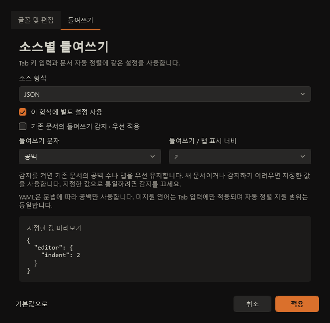
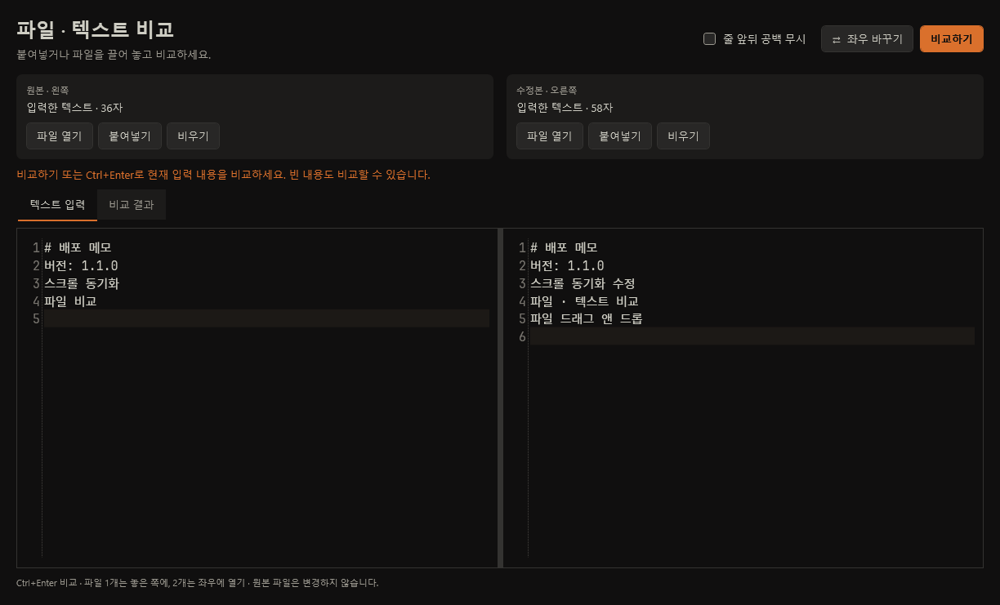
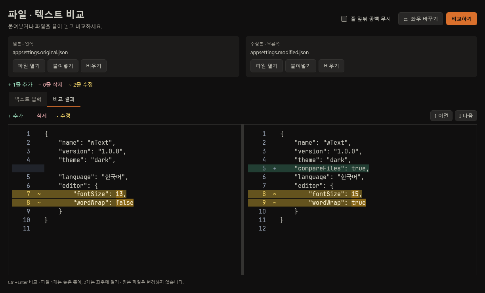
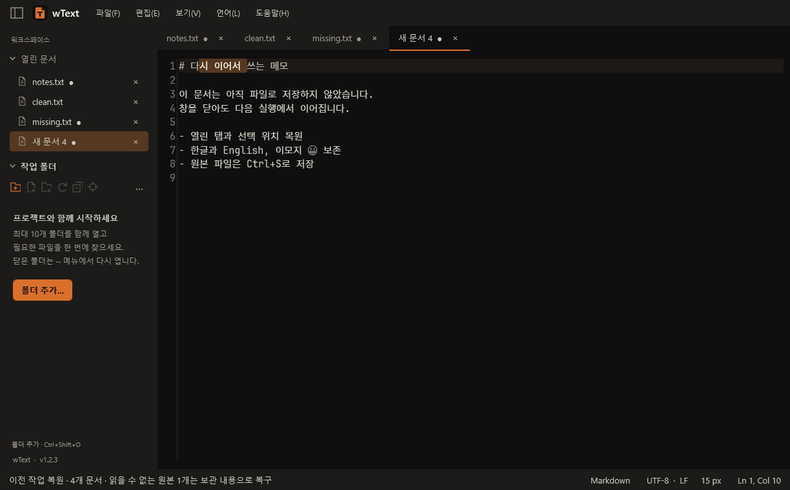
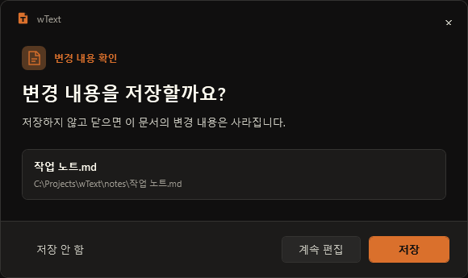
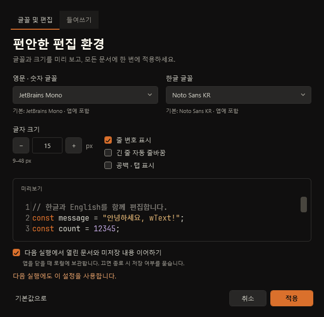
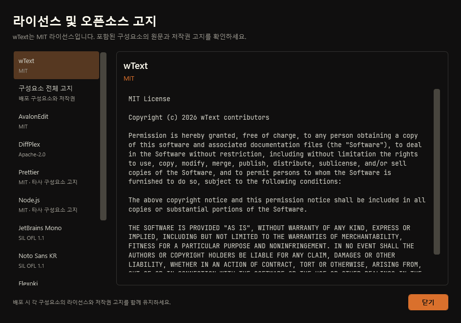

# wText 기능 및 사용법

[프로젝트 소개](../README.md) · [개발 안내](DEVELOPMENT.md)

## 기능 설명서 (F1)

**도움말 → 기능 설명서** 또는 **F1**로 앱에 내장된 설명서를 엽니다. 편집기·찾기 입력란·비교창·설정창에서도 사용할 수 있습니다. 16개 주제의 목차와 제목·본문 검색을 제공하며 `Ctrl+F`로 설명서 검색란에 이동하고 `Esc`로 닫습니다. 인터넷 연결 없이 읽고 본문을 선택해 복사할 수 있습니다. [전체 설명서 원문](USER-GUIDE.md)은 앱에 포함되는 동일한 문서입니다.

Windows 화면 생성 검사에 `user-guide.png`를 추가했습니다. 현재 환경에서는 실제 WPF 실행·새 화면 촬영을 하지 못했으며 아래 기존 화면과 구분합니다.

## 미니맵과 블록·줄 편집 (1.6.0)

오른쪽 미니맵은 문서 전체의 형태를 축소해 보여 줍니다. 음영 사각형은 현재 화면 범위, 주황색 선은 입력 커서 위치입니다. 클릭하거나 드래그하면 해당 줄 부근으로 화면만 이동하고 커서·선택은 유지됩니다. 미니맵 위에서도 휠 스크롤을 사용할 수 있습니다. 긴 문서는 일부 줄과 각 줄의 앞부분을 표본으로 그리며 구문 강조 색상은 표시하지 않습니다.

**보기 → 미니맵 표시**, 또는 **글꼴 및 편집 설정 → 우측 미니맵 표시**에서 켜고 끕니다. 기본값은 켜짐이며 모든 문서 탭과 다음 실행에 적용됩니다. 비교 창에는 적용하지 않습니다.

직사각형 블록은 **Alt+마우스 왼쪽 드래그** 또는 **Alt+Shift+방향키**로 선택합니다. 일반 선택을 만든 뒤 **편집 → 선택 영역을 직사각형 블록으로**를 사용할 수도 있습니다. 선택한 열에 입력하거나 Delete로 지우는 동작은 여러 줄에 적용됩니다.

| 동작 | 단축키 / 메뉴 |
| --- | --- |
| 블록 복사 | Ctrl+Shift+C; 일반 선택은 양 끝을 기준으로 직사각형으로 변환 |
| 블록 붙여넣기 | Ctrl+Shift+V; 외부 텍스트도 열 단위로 삽입 |
| 선택한 블록 잘라내기 / 복사 | Ctrl+X / Ctrl+C 또는 편집 메뉴 |
| 복사한 블록 붙여넣기 | Ctrl+V; 블록 형식을 가진 클립보드를 열 단위로 삽입 |
| 줄 또는 선택 내용 복제 | Ctrl+Alt+D |
| 현재 줄 / 선택한 줄 위·아래 이동 | Ctrl+Shift+↑ / ↓ |
| 현재 줄 / 선택한 줄 삭제 | Ctrl+Shift+K |
| 현재 줄 / 선택에 걸친 줄 전체 선택 | Ctrl+L |

예를 들어 `11`, `22`, `33`을 블록으로 복사하고 세 줄의 같은 열에 붙이면 각 줄에 각각 삽입됩니다. 짧은 대상 줄은 공백으로 채우고 문서 끝을 넘으면 기존 줄바꿈 형식으로 필요한 줄을 추가합니다. 선택한 블록에 한 줄을 붙이면 각 줄에 반복하고, 여러 줄을 붙일 때는 선택한 줄 수와 같아야 합니다. 줄 수가 다르면 안내 후 원문을 유지합니다. 일반 선택이 남아 있다면 선택을 해제하거나 직사각형으로 변환한 뒤 블록 붙여넣기를 사용하세요.

블록 붙여넣기와 줄 편집은 각각 Ctrl+Z 한 번으로 되돌립니다. 직사각형 선택 중 줄 복제·이동·삭제·줄 선택은 비활성화되며, 일반 선택으로 돌아오면 사용할 수 있습니다. 새 명령은 검색 결과 동시 편집을 종료하고 현재 문서에 적용합니다. 단축키는 본문 편집기에 포커스가 있을 때 동작하며 기존 비교 단축키 Ctrl+Shift+D는 유지합니다.

**화면 검증 상태:** 새 `minimap.png` 생성 코드는 WPF 회귀 검사에 포함했습니다. Linux에서는 WPF를 실행할 수 없어 실제 1.6.0 화면은 아직 촬영하지 않았습니다. 아래 기존 화면은 새 미니맵·블록 메뉴의 검증 자료가 아닙니다.

### Sublime Text 벤치마크 범위

[Sublime Text 열 선택 공식 문서](https://www.sublimetext.com/docs/column_selection.html)에서 직사각형 선택 흐름을, [공식 API의 미니맵 표시·숨김](https://www.sublimetext.com/docs/api_reference.html)에서 탐색 영역과 가시성 제어를 참고했습니다. 단축키는 wText의 기존 비교·검색과 AvalonEdit의 열 선택 동작에 맞췄습니다. 여러 개의 불연속 블록이나 임의 위치 다중 커서는 이번 구현 범위에 포함하지 않습니다.

이번에는 미니맵·열 편집과 줄 편집을 추가하고, 이미 있는 빠른 파일 찾기(Ctrl+P), 검색 결과 동시 편집, 집중 모드(F11)를 유지했습니다. 명령 팔레트, 심볼 이동, 코드 접기, 자유 다중 커서는 후속 후보입니다. Sublime Text 소스·에셋·플러그인은 포함하지 않았으며 기존 MIT AvalonEdit 의존성을 사용합니다.

## 설치 및 실행

배포본에는 .NET 런타임이 포함됩니다. 설치 마법사는 현재 사용자 폴더와 시작 메뉴에 설치하며 관리자 권한이 필요하지 않습니다. Windows 설정의 앱 목록에서 제거할 수 있습니다. 기존 텍스트 파일 연결은 변경하지 않습니다.

설치 중 **바로가기 설정 → 바탕화면에 wText 바로가기 만들기**를 선택할 수 있습니다. 처음에는 체크되어 있으며 재설치·업그레이드는 이전 선택을 기억합니다. 체크를 해제하면 기존 바탕화면 바로가기도 제거하고, 시작 메뉴 바로가기는 유지합니다. 프로그램 제거 시 두 바로가기를 함께 정리합니다.

## 화면으로 보는 사용법

### 찾기·바꾸기 입력하기

**1.3.0부터 지원:** 검색어를 입력하면 현재 문서의 모든 일치 항목을 블록 배경으로 강조하고 개수를 표시합니다. **이전 찾기 / 다음 찾기** 또는 `Shift+F3` / `F3`로 이동하며, 입력란에서는 `Shift+Enter` / `Enter`를 사용합니다. 끝에 도달하면 반대쪽에서 계속 찾습니다. 대소문자 옵션과 본문 변경도 바로 반영합니다.

**바꾸기 표시/숨기기** 또는 `Ctrl+H`로 바꿀 내용을 입력하세요. **바꾸기**는 현재 선택한 일치 항목을 바꾸고, **모두 바꾸기**는 현재 문서 전체에 적용합니다. `Ctrl+Z` 한 번으로 모두 바꾸기를 취소할 수 있습니다. 빈 검색어는 변경하지 않으며 정규식이 아닌 일반 문자열 검색입니다. `Esc`로 닫으면 강조가 사라집니다.

아래 화면은 1.3.0의 실제 Windows WPF 검증 결과입니다. 1.4.2 이후 버전에는 이 기능과 검색 결과 동시 편집·저장 확인 단축키가 포함됩니다.

**편집 → 찾기 / 바꾸기**를 클릭하거나 `Ctrl+F` / `Ctrl+H`를 누르면 두 경우 모두 **찾을 내용** 입력란으로 포커스가 이동합니다. 이미 열려 있어도 다시 이동하며, 기존 검색어를 전체 선택하여 바로 새 검색어를 입력할 수 있습니다. 본문에서 한 줄의 텍스트를 선택했다면 검색어로 채워집니다.

### 검색 결과를 동시에 수정하기 (1.4.0)

1. `Ctrl+F`로 찾을 내용을 입력하고 강조된 결과를 확인합니다.
2. **검색 결과 동시 편집** 체크박스를 켭니다. 현재 일치 항목(없으면 첫 항목)이 선택되고 본문으로 포커스가 이동합니다.
3. 그대로 입력하면 모든 검색 결과가 함께 바뀝니다. 예를 들어 `name = name; print(name);`에서 `name`을 찾고 체크한 뒤 `value`를 입력하면 세 곳 모두 `value`가 됩니다. 각 항목 안에서 커서를 이동하거나 일부만 선택해 수정할 수도 있습니다.
4. 입력·붙여넣기·잘라내기·Backspace/Delete가 모든 대상에 적용됩니다. Enter와 Tab도 입력할 수 있습니다. 체크 당시의 항목만 유지하므로 입력한 내용에 검색어가 포함돼도 대상이 늘어나지 않습니다.
5. `Esc` 또는 체크 해제로 일반 편집으로 돌아갑니다. `Ctrl+Z`는 마지막 입력을 모든 대상에서 함께 취소하고 동시 편집을 끝냅니다. 다시 실행도 전체 대상에 적용됩니다.

검색어·대소문자 변경, 탭 전환, 찾기 닫기, 일반 바꾸기 실행 시 동시 편집이 끝납니다. 대상 밖에 입력하거나 문서 정렬 등 다른 편집 명령을 사용해도 종료됩니다. 삭제 키에 Ctrl/Shift 등을 조합하는 단어·행 편집은 일반 편집으로 전환합니다. Backspace/Delete는 대상 경계를 넘어 주변 글자를 지우지 않습니다.

위 검색 화면은 **1.3.0**입니다. 사용자 PC에서 기능 동작을 확인하고 1.4.1로 공개했습니다. 새 체크박스 화면과 한글 IME에 대한 자동·전문 검증은 아직 진행하지 않았습니다. 새 WPF 회귀 검사와 `search-linked-editing.png` 생성 코드는 준비했으며, CI는 사용자 요청에 따라 실행하지 않습니다.

### 파일을 찾아 편집하기

`Ctrl+Shift+O`로 프로젝트 폴더를 열고 `Ctrl+P`로 파일명·경로를 검색하세요. 왼쪽 탐색기에서 파일 형식과 폴더 구조를 구분하고, 우클릭이나 `F2`로 이름을 바꿀 수 있습니다. `Ctrl+Shift+E`는 편집 중인 파일의 위치를 찾아줍니다.

### 여러 작업 폴더 관리하기

탐색기의 **폴더 추가** 버튼이나 `Ctrl+Shift+O`로 최대 10개 폴더를 함께 여세요. 여러 폴더를 선택하거나 드롭할 수 있습니다. 각 폴더 행의 **×**로 개별 닫기, 우클릭으로 순서 변경, **···** 메뉴로 전체 닫기와 최근 폴더 다시 열기가 가능합니다. 폴더를 닫아도 파일과 편집 중인 문서는 유지됩니다.

### 문서 자동 정렬하기

**보기 → 문서 자동 정렬** 또는 `Ctrl+Shift+F`로 현재 문서 전체의 들여쓰기와 줄바꿈을 정리합니다. JSON·JSONC·JavaScript(JSX)·TypeScript(TSX)·HTML·Vue·CSS·SCSS·Less·YAML·Markdown을 지원합니다. 파일 확장자 또는 언어 메뉴에서 선택한 형식을 사용하며, 새 문서에 붙여넣은 JSON 객체·배열은 자동 인식합니다. 다른 형식을 붙여넣었다면 먼저 **언어** 메뉴에서 선택하세요.

들여쓰기는 기본적으로 기존 문서에서 감지한 공백 수나 탭을 유지합니다. 감지하기 어려운 문서는 언어별 설정 또는 공통 기본값(공백 4칸)을 사용합니다. 줄 길이 기준은 100자입니다. 문법에 따라 실제 줄 길이는 달라질 수 있습니다. 인코딩과 마지막 줄바꿈 유무를 유지하고, 줄바꿈은 문서의 첫 줄바꿈 방식으로 맞춥니다. 결과는 미저장 변경으로 적용하며 **Ctrl+Z 한 번**으로 원문으로 돌아갑니다. 문법 오류·미지원 형식·200만 자 초과·30초 시간 초과 시 원문을 유지하고 이유를 안내합니다. 자동 정렬 지원 범위는 구문 강조 지원 범위보다 좁습니다.

정렬은 배포본에 포함된 Prettier와 Node.js로 로컬에서 실행됩니다. 사용자 PC에 별도 도구를 설치할 필요가 없으며, 문서나 프로젝트의 설정 파일을 실행하거나 네트워크로 문서를 전송하지 않습니다.

### 언어별 들여쓰기 설정하기

**보기 → 글꼴 및 편집 설정 → 들여쓰기**에서 공통 기본값 또는 소스 형식을 선택하세요. JSON·JSONC·JavaScript·TypeScript·HTML·Vue·CSS·SCSS·Less 등을 각각 설정할 수 있으며, 다른 언어도 Tab 키 입력 설정을 지원합니다.

- **이 형식에 별도 설정 사용**: 켜면 해당 언어에 독립적인 설정을 저장하고, 끄면 공통 기본값을 따릅니다.
- **공백 / 탭**, **1~8칸 너비**: Tab 입력과 지원 언어의 자동 정렬에 적용합니다. 탭 문서의 표시 너비는 지정한 값을 사용합니다.
- **기존 문서의 들여쓰기 감지 · 우선 적용**: 기본적으로 켜져 있습니다. 기존의 2칸·4칸 공백이나 탭을 감지하여 단순한 들여쓰기 차이로 재정렬되는 일을 줄입니다. 비어 있거나 혼합·정렬용 공백 때문에 감지하기 어려우면 지정값을 사용합니다. 원하는 너비로 통일하려면 이 옵션을 끄세요.

설정을 적용해도 본문은 바뀌지 않습니다. 실제 변환은 **문서 자동 정렬**을 실행할 때 이루어지며 `Ctrl+Z`로 되돌릴 수 있습니다. 감지는 선행 공백을 이용한 추정이고, 따옴표·줄 길이 등 다른 포맷 규칙까지 다른 IDE와 같게 맞추는 기능은 아닙니다. YAML은 문법에 맞춰 공백만 사용합니다.

### 파일과 붙여넣은 텍스트 비교하기

**보기 → 파일 · 텍스트 비교** 또는 `Ctrl+Shift+D`로 비교창을 여세요. **텍스트 입력**의 좌우 칸에 직접 입력하거나 `Ctrl+V`로 붙여넣고, **비교하기** 또는 `Ctrl+Enter`를 누르세요. 파일명과 **파일 열기 / 붙여넣기 / 비우기**는 각 편집기 위 한 줄에 표시합니다. 긴 파일명은 말줄임하며 마우스를 올리면 전체 경로를 볼 수 있습니다. 각 칸의 **붙여넣기** 버튼은 그쪽 전체 내용을 클립보드 텍스트로 바꾸며, **비우기**와 함께 `Ctrl+Z`로 되돌릴 수 있습니다. 한쪽 또는 양쪽이 비어 있어도 비교할 수 있습니다.

**파일 열기** 버튼이나 파일 드래그도 사용할 수 있습니다. 파일 **한 개**는 놓은 쪽에, **두 개**는 전달된 순서대로 좌우에 열립니다. 입력 칸·파일 이름 카드·비교 결과 어디에 놓아도 됩니다. 두 파일이 준비되면 자동으로 비교하며, 파일과 직접 입력한 텍스트를 섞어 비교할 수도 있습니다. 좌우가 반대라면 **좌우 바꾸기**를 누르세요. 폴더·세 개 이상의 파일은 받지 않으며, 읽기 실패나 인코딩 선택 취소 시 기존 입력을 유지합니다.

**비교 결과**에서는 추가·삭제·수정 줄과 변경된 단어를 표시하고 양쪽 스크롤을 맞춥니다. 우측 하단의 굵은 변경 줄 수와 결과 범례는 **추가=초록, 삭제=빨강, 수정=노랑**으로 구분합니다. 수정 줄에는 진한 노란 배경을, 변경된 단어에는 더 밝은 배경을 표시합니다. 이전·다음 변경 버튼 또는 `Shift+F7`·`F7`로 이동하세요. **텍스트 입력**으로 돌아가 수정하면 이전 결과를 비활성화하므로 다시 **비교하기**를 누르면 됩니다. 입력 내용과 실행 취소 기록은 두 화면을 오가도 유지됩니다.

파일은 열 때 읽은 내용을 비교용으로 가져오며, 비교창에서 수정해도 원본 파일에 저장하지 않습니다. 본문 편집기의 미저장 내용을 비교하려면 복사해서 붙여넣으세요. 비교창 입력은 임시 내용으로 창을 닫으면 사라지며 작업 복원 대상에 포함되지 않습니다.

### 닫았던 작업 이어하기

창의 **X** 또는 **파일 → 끝내기**는 기본적으로 탭과 미저장 내용을 로컬에 보관합니다. 다시 실행하면 문서 순서·선택한 탭·커서·선택 영역과 언어 모드를 복원합니다. 탭의 ● 표시는 아직 원본 파일에 저장하지 않은 내용이라는 뜻입니다.

### 저장 여부를 분명하게 선택하기

개별 탭을 닫으면 파일 이름과 경로가 표시된 확인창에서 **저장 / 저장 안 함 / 계속 편집**을 선택합니다. `Esc`나 확인창의 **×**도 계속 편집으로 처리합니다. 오류와 인코딩 확인도 같은 테마를 사용하며 긴 오류 내용은 **자세한 내용**에서 확인할 수 있습니다.

### 글꼴과 작업 보관 설정하기

**보기 → 글꼴 및 편집 설정** 또는 `Ctrl+,`에서 한글·영문 글꼴과 크기를 미리 보고 적용하세요. **다음 실행에서 열린 문서와 미저장 내용 이어하기**를 끄면 종료할 때 저장 여부를 묻습니다. `Ctrl+B`로 사이드바를 숨기고 `F11`로 편집에 집중할 수도 있습니다.

글꼴·들여쓰기 선택 상자는 값이나 빈 공간을 눌러도 목록이 열립니다. 글꼴 이름 직접 입력도 유지하며, `F4`로 열고 `Esc`로 닫을 수 있습니다.

선택한 탭은 본문에서 마우스를 움직이거나 포커스를 옮겨도 배경색을 유지합니다. 탭과 열린 문서 목록의 키보드 포커스는 어두운 테두리로 구분합니다.

### 라이선스 원문 확인하기

**도움말 → 라이선스 및 오픈소스 고지**에서 wText의 MIT 라이선스와 구성요소별 원문을 읽을 수 있습니다. **wText 정보**에서도 같은 화면으로 이동할 수 있으며, 글꼴의 OFL 고지와 배포 도구·런타임 고지도 포함합니다.

위 이미지는 실제 WPF 화면을 예제 문서로 렌더링한 것입니다. 클릭하면 원래 크기로 볼 수 있습니다.

## 현재 기능

- 다중 탭, 파일·폴더 드래그 앤 드롭, 실행 인자의 파일 열기
- 파일 형식별 아이콘·폴더 우선 자연 정렬, 비동기 프로젝트 탐색과 파일 이름·경로 검색
- 파일·폴더 생성과 이름 변경, 경로 복사, 현재 문서 위치 찾기, 외부 변경 자동 갱신
- 최대 10개 작업 폴더, 개별·전체 닫기, 목록 순서 변경, 최근 폴더 10개에서 다시 열기
- 열린 폴더 목록·순서·펼침 상태 복원, 숨김·빌드·의존성 폴더 표시 선택
- wShell을 참고한 블랙·오렌지 테마, 테두리 없는 메뉴, 작업표시줄에서 구분되는 문서/T 아이콘
- 열린 문서·탐색기 개별 접기, 사이드바 전체 숨기기·너비 조절, F11 집중 모드
- 영문·숫자 JetBrains Mono + 한글 Noto Sans KR 기본 글꼴 동봉; 설치된 글꼴 선택과 크기 미리보기
- 줄 번호, 자동 줄바꿈, 공백 표시, 글자 크기 조절, 실행 취소·다시 실행
- YAML, HTML, JavaScript, TypeScript, JSP, Java, JSON, XML, CSS, C#, C/C++, Python, SQL, PowerShell, Shell, INI/TOML/Properties, Markdown, PHP 및 일반 텍스트 모드
- 1.4.0: 검색 결과 동시 편집 체크박스, 연속 입력·붙여넣기·삭제와 입력 단위 전체 실행 취소
- 일반 텍스트 검색, 대소문자 구분, 바꾸기·모두 바꾸기; 1.3.0에서는 전체 결과 강조·개수·현재 위치·이전/다음 순환 이동 제공
- UTF-8, BOM이 있는 UTF-16/32, 사용자 확인 후 CP949 열기와 원본 인코딩·줄바꿈 보존
- 창 종료 후 탭·미저장 내용 복원, 주기적인 로컬 복구본, 개별 탭을 버릴 때 저장 확인
- 테마에 맞춘 저장·인코딩 확인과 오류 알림, 문서 경로 표시와 선택 가능한 오류 상세 내용
- 외부 변경 감지, 임시 파일을 통한 원본 교체 저장, 도움말의 라이선스 원문 보기
- 파일·직접 입력·붙여넣기 텍스트의 혼합 비교, 비교창 파일 드롭, 좌우 교환, 입력 편집과 실행 취소
- 추가·삭제·수정 줄 및 단어 표시, 스크롤 동기화, 변경 구간 이동, 공백 옵션, 줄바꿈·파일 인코딩 차이 안내

파일 열기·저장은 16 MiB, 비교는 한쪽당 500,000자·20,000줄까지 지원합니다. 비교 한도를 초과한 입력은 지우지 않고 안내하므로 내용을 줄여 다시 비교할 수 있습니다. 정규식 검색, 임의 위치 다중 커서, 비교 병합은 아직 제공하지 않습니다. 미니맵과 직사각형 블록 편집은 1.6.0부터 지원합니다.

## 종료와 작업 복원

저장 확인창이 나타나면 **Y → 저장**, **N → 저장 안 함**, **C 또는 Esc → 계속 편집**을 사용할 수 있습니다(1.4.1). 버튼에 단축키를 표시하며 Enter와 Tab을 이용한 기존 조작도 유지합니다. 키를 누르고 있을 때 생기는 반복 입력과 Ctrl/Alt/Windows 조합은 처리하지 않습니다. 오류·인코딩 확인창에는 Y/N/C 단축키를 적용하지 않습니다. 이 문서의 기존 저장 확인 화면에는 새 단축키 표시가 없으며, 사용자 PC에서 단축키 동작을 확인했습니다. 새 Windows 화면 캡처는 아직 갱신하지 않았습니다.

- **창 X / 끝내기:** 기본 설정에서는 저장 여부를 묻지 않고 현재 작업을 보관한 뒤 종료합니다. 파일에 반영할 때는 `Ctrl+S`를 사용하세요.
- **개별 탭 X / Ctrl+W:** 미저장 문서는 저장 여부를 묻습니다. **저장 안 함**으로 닫은 탭은 다음 실행에서 복원하지 않습니다.
- **작업 이어하기를 끈 경우:** 창을 닫을 때도 **저장 / 저장 안 함 / 계속 편집**으로 저장·버리기·종료 취소를 선택합니다.

복구본은 `%LocalAppData%\wText\sessions\`에 저장합니다. 입력이 멈춘 뒤 약 2초, 계속 입력 중에는 최대 10초 간격으로 백그라운드에 보관하고 정상 종료 시 마지막 변경까지 기록합니다. 보관에 실패하면 창을 열어 두어 내용을 저장하거나 다시 시도할 수 있습니다. 이전 복구본도 유지하며 손상된 파일은 덮어쓰지 않습니다.

저장한 뒤 수정하지 않은 파일은 재실행 시 최신 디스크 내용을 읽습니다. 미저장 버퍼는 보관 내용을 유지하며, 원본이 외부에서 바뀌었으면 덮어쓰기를 막습니다. 원본 파일이 없어졌거나 읽을 수 없으면 보관 내용으로 복구하고 안내합니다. 실행 취소 기록은 재실행 후 새로 시작합니다.

창별 보관 파일을 잠가 여러 실행이 같은 작업을 덮어쓰지 않도록 합니다. 여러 창을 사용했다면 가장 최근의 사용 가능한 작업부터 복원하며, 추가 실행에서 다른 보관 작업을 열 수 있습니다. 보관 한도는 창당 문서 256개·JSON 파일 128 MiB입니다. 강제 종료·전원 장애 때는 마지막 주기적 보관 이후 입력이 남지 않을 수 있습니다.

## 프로젝트 탐색기

`Ctrl+Shift+O` 또는 폴더 드롭으로 작업 폴더를 추가합니다. 기존 폴더를 유지하면서 최대 10개를 열며, 이미 열린 경로는 중복 추가하지 않습니다. 11번째 폴더는 기존 목록을 유지한 채 한도를 안내합니다.

화살표 키로 이동하고 `Enter`나 더블 클릭으로 파일을 여세요. `Ctrl+P`는 열린 폴더 전체에서 이름·상대 경로를 검색합니다. `src editor`처럼 공백으로 검색어를 조합하거나 `api-server index`처럼 작업 폴더 이름으로 좁힐 수 있습니다. 검색 결과에 소속 폴더를 표시하며, 전체 경로는 마우스를 올려 확인합니다.

탐색기 툴바에서 **새 파일·새 폴더·새로고침·모두 접기·현재 문서 찾기**를 실행할 수 있습니다. 우클릭 메뉴에는 이름 변경(`F2`), 상대·전체 경로 복사, Windows 탐색기에서 보기가 있습니다. 이름을 바꾸면 열린 문서의 경로도 바뀌며 미저장 내용과 실행 취소 기록을 유지합니다. 외부 파일 추가·삭제·이름 변경은 자동 반영하며 `F5`로 직접 갱신할 수도 있습니다.

| 폴더 정리 | 사용 방법 |
| --- | --- |
| 개별 접기·펼치기 | 작업 폴더 행의 화살표, 또는 선택 후 `Enter` |
| 개별 닫기 | 폴더 행의 **×**, 또는 우클릭 → **작업 폴더 닫기** |
| 순서 변경 | 작업 폴더 우클릭 → **목록에서 위로 / 아래로** |
| 전체 닫기 | **··· → 모든 작업 폴더 닫기** |
| 다시 열기 | **··· → 최근 작업 폴더**에서 선택; 최근 10개 유지 |
| 기록 정리 | **··· → 최근 폴더 기록 지우기** |

폴더 닫기는 탐색기 목록에서만 제거하며 파일과 열린 문서는 유지합니다. 작업 폴더 자체는 목록에서 닫은 후 상위 폴더에서 이름을 변경하세요. `.git`, `node_modules`, `bin`, `obj` 등의 생성 폴더와 Windows 숨김 항목은 기본적으로 제외하며 **···** 메뉴에서 다시 표시할 수 있습니다.

열린 폴더 목록·순서·각 폴더의 접힘 상태·하위 폴더 펼침 최대 200개씩·필터는 `%LocalAppData%\wText\settings.workspace.json`에 저장합니다. 0.4.0의 단일 폴더 설정은 자동으로 옮깁니다. 접근할 수 없는 폴더도 목록에 유지하므로 연결을 복구한 뒤 `F5`로 다시 읽거나 닫을 수 있습니다. 최종 목록 기록에 실패하면 창을 닫지 않습니다.

폴더는 필요할 때 불러오고 보이는 행 위주로 렌더링합니다. 폴더 하나당 파일·하위 폴더 합계 10,000개까지 표시하며, 파일 검색은 열린 작업 폴더 전체에 걸쳐 최대 100,000개 항목을 확인해 결과 200개까지 보여줍니다. 겹치는 작업 폴더의 같은 파일은 결과에서 중복 제거합니다. 한도 도달 시 검색어를 구체화하세요. 연결 폴더는 자동으로 순회하지 않습니다. 검색 대상은 파일 이름·경로이며 파일 내용 전체 검색은 후속 범위입니다.

## 편집 환경 설정

**보기 → 글꼴 및 편집 설정**, 상태 표시줄의 글자 크기 또는 `Ctrl+,`로 설정을 엽니다. 한글·영문 글꼴을 따로 선택하고 9–48 px 범위에서 미리 본 뒤 적용하세요. 모든 탭과 비교창에 함께 반영되며 문서 내용·커서·실행 취소 기록은 유지됩니다. 비교창은 줄 정렬을 위해 자동 줄바꿈을 사용하지 않습니다.

확장자로 언어를 감지하며, **언어** 메뉴나 상태 표시줄에서 직접 바꿀 수 있습니다. 새 문서도 저장 전에 언어를 지정할 수 있고 **자동 감지**로 돌아갈 수 있습니다. 구문 강조는 어휘 기반이며 자동 완성이나 컴파일 오류 검사는 제공하지 않습니다.

글꼴·크기·편집 옵션과 사이드바 너비·표시·접힘 상태는 `%LocalAppData%\wText\settings.json`에 저장합니다. 설치형과 무설치형이 같은 사용자 설정을 사용합니다. 집중 모드는 일시적이며, 종료하면 기존 사이드바 표시 상태를 복원합니다. **도움말 → wText 정보**에는 제작자, 버전, GitHub 링크와 주소 복사가 있습니다.

## 단축키

| 단축키 | 동작 |
| --- | --- |
| `F1` | 내장 기능 설명서 (설명서에서 Ctrl+F 검색, Esc 닫기) |
| `Ctrl+N`, `Ctrl+O`, `Ctrl+S` | 새 문서(편집기에 바로 입력·붙여넣기), 열기, 저장 |
| `Ctrl+Shift+S`, `Ctrl+W` | 다른 이름으로 저장, 탭 닫기 |
| `Ctrl+F`, `Ctrl+H`, `F3`, `Shift+F3` | 찾기, 바꾸기, 다음·이전 찾기 |
| `Enter`, `Shift+Enter` (찾을 내용 입력란) | 다음·이전 찾기 |
| `Y`, `N`, `C` / `Esc` (저장 확인창) | 저장, 저장 안 함, 계속 편집 |
| `Ctrl+Z`, `Ctrl+Y` | 실행 취소, 다시 실행 |
| `Ctrl+Tab`, `Ctrl+Shift+Tab` | 다음·이전 탭 |
| `Ctrl+Shift+F` | 현재 문서 자동 정렬 |
| `Ctrl+Shift+D` | 파일 · 텍스트 비교창 열기 |
| `Ctrl+Enter` | 비교창의 현재 입력 비교 |
| `F7`, `Shift+F7` | 비교창에서 다음·이전 변경 구간 |
| `Ctrl+Shift+O`, `Ctrl+P` | 작업 폴더 추가, 열린 폴더 전체 이름·경로 검색 |
| `Ctrl+Shift+E` | 탐색기에서 현재 문서 찾기 |
| `F2`, `F5` | 탐색기에서 이름 변경, 새로고침 |
| `Ctrl+Shift+C` | 탐색기에서 선택 항목의 전체 경로 복사 |
| `Ctrl+B` | 사이드바 접기·펼치기 |
| `F11`, `Esc` | 집중 모드 전환, 검색 닫기·집중 모드 나가기 |
| `Ctrl+,` | 글꼴 및 편집 설정 |
| `Ctrl++`, `Ctrl+-` | 글자 크게·작게 |
| `Ctrl+0` | 기본 글자 크기 15 px |

## 라이선스

자체 코드는 [MIT](../LICENSE)입니다. AvalonEdit(MIT), DiffPlex(Apache-2.0), JetBrains Mono·Noto Sans KR(OFL-1.1), Flexoki(MIT), Prettier·Node.js(MIT 및 포함 구성요소 고지), .NET/WPF, NSIS의 고지는 [THIRD-PARTY-NOTICES.md](../THIRD-PARTY-NOTICES.md)를 확인하세요. 글꼴은 앱 폴더에서 직접 불러오며 Windows에 별도로 설치하지 않습니다. Sublime Text와 Notepad++는 사용성 참고 대상이며 해당 제품의 코드나 이미지를 포함하지 않습니다.

## 열린 파일의 외부 변경 (1.5.0)

다른 프로그램에서 열린 파일을 수정하면 창으로 돌아올 때, 또는 활성 창에서 약 2초마다 변경을 확인합니다. 작업 폴더 밖의 파일과 비활성 탭도 확인합니다. 저장 시각만 바뀌거나 wText에서 직접 저장한 경우에는 알리지 않습니다.

- 미저장 수정이 없는 탭은 새 내용을 반영하고 파일 이름·경로가 있는 알림을 표시합니다.
- 편집 중인 탭은 **계속 편집 / 수정 버리고 다시 불러오기 / 취소**를 선택합니다. 기본 선택은 계속 편집이며 Esc·X도 내용을 유지합니다. 유지한 내용은 **다른 이름으로 저장**할 수 있고, 외부 변경된 원본을 덮어쓰는 저장은 차단합니다.
- 같은 디스크 버전에 대한 알림은 한 번만 표시합니다. 이후 다시 불러오려면 **파일 → 파일 다시 불러오기**를 선택하세요. 수정 내용이 있으면 다시 확인합니다.
- 삭제·이동·잠금·지원하지 않는 내용 등으로 읽지 못하면 현재 버퍼를 보존하고 안내합니다. 파일 접근이 복구되면 다시 확인합니다.

다시 불러오기는 새 파일의 인코딩·줄바꿈을 반영하며 언어 선택과 표시 위치를 유지합니다. 짧아진 문서의 커서는 유효 범위로 조정하고 실행 취소 기록은 초기화합니다. 이 기능은 편집 탭에 적용되며 별도 비교 창의 입력은 자동 갱신하지 않습니다.

새 알림 화면은 Linux에서 WPF 실행이 불가능하여 아직 촬영하지 않았습니다. 기존 화면은 이전 버전의 실제 Windows 검증 결과입니다.
